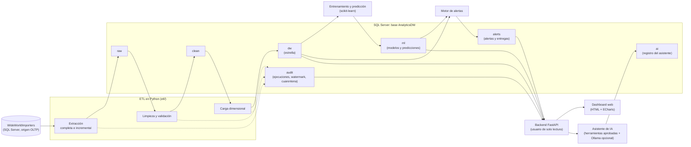

# 2. Arquitectura de la solución

## Diagrama general

## Capas
| Capa | Responsabilidad | Resultado |
|---|---|---|
| Fuente | Registrar transacciones | `WideWorldImporters` (SQL Server 2022 Developer en Docker) |
| Extracción | Leer datos completos o cambios | Tablas `raw.*` con linaje (`_execution_id`, `_loaded_at`) |
| Staging raw | Conservar lo recibido | `raw.*` |
| Staging clean | Limpiar, validar, enriquecer | `clean.*` + `audit.quarantine` |
| Data Warehouse | Modelo dimensional | `dw.FactSales`, `dw.DimDate`, `dw.DimCustomer`, `dw.DimProduct` |
| BI / API | Exponer métricas | FastAPI + dashboard |
| ML / GenAI | Predicciones y explicaciones | `ml.*`, asistente |
| Notificaciones | Comunicar condiciones relevantes | `alerts.*` + dashboard (+ correo opcional) |
| Monitoreo | Transversal | `audit.etl_run`, pestaña *Operación (ETL)* |

## Decisiones técnicas y justificación
| Decisión | Elección | Justificación |
|---|---|---|
| Extracción | **Por lotes.** Hechos (órdenes y líneas) incrementales por `LastEditedWhen`; catálogos completos | El origen tiene columna de auditoría confiable; los catálogos son pequeños y recargarlos completos es más simple y seguro |
| Staging | Separa `raw` (lo recibido) de `clean` (lo validado) | Permite reconstruir `clean` sin volver a tocar el origen y auditar los rechazos |
| Herramienta ETL | **Python + SQL** (pandas, SQLAlchemy, procedimientos T-SQL) | La guía permite Python + SQL Server para un proyecto de este tamaño; evita la complejidad de Hop/Airflow |
| Orquestación | `etl/run_pipeline.py` (secuencial, se detiene al fallar) | No hay dependencias complejas que justifiquen Airflow. Para programarlo: Programador de tareas de Windows o cron |
| Fallas y reintentos | Cada paso en una transacción; el watermark avanza solo si todo termina bien; todo es idempotente | Reejecutar es seguro. Demostrado con la falla controlada (`06_demo_recovery.sql`) |
| Registros tardíos | Ventana de solapamiento de 1 día sobre el watermark + upsert por clave | Re-procesar filas ya cargadas no duplica ni altera resultados |
| Hechos y dimensiones | Hechos: upsert por `OrderLineID`. Productos: SCD 1. Clientes: SCD 2 (categoría y ubicación) y SCD 1 (nombre) | Ver `04_modelo_dimensional.md` |
| Esquema | Estrella (no copo de nieve) | Más simple de consultar; no hay jerarquías que justifiquen normalizar |
| Dashboard | HTML + Apache ECharts servidos por FastAPI | Equivalente justificado a React: sin Node ni compilación; mismo resultado funcional |
| Frecuencia del dashboard | Consulta el DW al instante; el DW se refresca cuando corre el pipeline. El aviso de alertas nuevas se consulta cada 30 s | Coherente con un DW por lotes |
| «Tiempo real» | **No hay tiempo real.** La oportunidad es la del último lote (medible con `audit.etl_run`) | Un ETL por lotes no produce alertas inmediatas; para eso haría falta CDC o procesamiento continuo |
| Contenedores | Solo SQL Server corre en Docker. ETL, API y ML corren en un entorno virtual de Python | Reduce la complejidad para el equipo; el motor es lo difícil de instalar |
| IA generativa | Reglas deciden qué consultar; el modelo (Ollama local, opcional) solo redacta | Un modelo pequeño es poco fiable para planear; así las respuestas son verificables |

## Seguridad
- Secretos solo en `.env` (excluido por `.gitignore`); `.env.example` sin credenciales reales.
- ETL y administración usan `sa` (limitación por tiempo, declarada). La API usa `api_reader`: `SELECT` sobre `dw`, `ml`, `alerts` y dos tablas de `audit`; `UPDATE` solo de 3 columnas de `alerts.alert`; `INSERT` en `ai.assistant_log`.
- Consultas parametrizadas; los nombres de columnas dinámicos salen de listas blancas.
- Tokens firmados (HMAC) con expiración de 8 horas; comparación en tiempo constante; pausa ante credenciales erróneas.
- Límite de 20 preguntas/minuto por usuario al asistente.
- Con modelos externos se bloquea el desglose por cliente; con Ollama nada sale del equipo.

## Costos
Todo es local y sin costo de licencias para desarrollo y pruebas: SQL Server Developer, Python y sus librerías, Docker Desktop (revisar la licencia según el caso), ECharts (CDN gratuito) y Ollama. Un servicio de IA externo tendría costo por uso.
