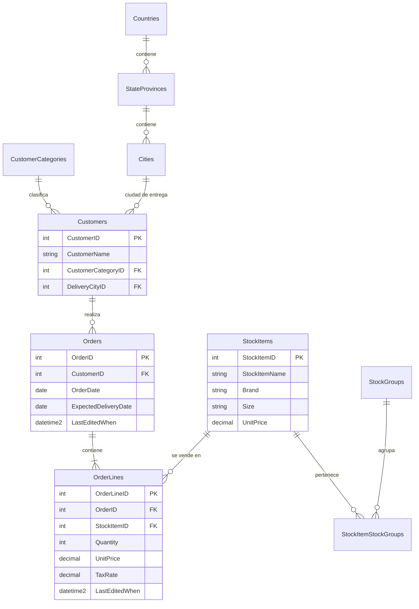

# 3. Fuente de datos y diccionario

## Elección del origen: WideWorldImporters
Base de ejemplo de Microsoft para SQL Server con un negocio de importación y distribución mayorista. Se eligió por: volumen suficiente (cientos de miles de líneas de venta), variedad de entidades (clientes, productos, ubicaciones), **fechas de 2013 a 2016** que permiten tendencias y pronóstico, y columnas de auditoría (`LastEditedWhen`) que permiten carga incremental. Limitación: son pocos meses de historia (~41), lo que condiciona el modelo de ML.

## ERD de las tablas de origen utilizadas

## Tablas extraídas (10)
| Origen | Destino raw | Clave | Tipo | Carga |
|---|---|---|---|---|
| `Sales.Orders` | `raw.orders` | `OrderID` | Transaccional | Incremental (`LastEditedWhen`) |
| `Sales.OrderLines` | `raw.order_lines` | `OrderLineID` | Transaccional | Incremental (`LastEditedWhen`) |
| `Sales.Customers` | `raw.customers` | `CustomerID` | Catálogo | Completa |
| `Sales.CustomerCategories` | `raw.customer_categories` | `CustomerCategoryID` | Catálogo | Completa |
| `Warehouse.StockItems` | `raw.stock_items` | `StockItemID` | Catálogo | Completa |
| `Warehouse.StockGroups` | `raw.stock_groups` | `StockGroupID` | Catálogo | Completa |
| `Warehouse.StockItemStockGroups` | `raw.stock_item_stock_groups` | `StockItemStockGroupID` | Relación N:M | Completa |
| `Application.Cities` | `raw.cities` | `CityID` | Catálogo | Completa |
| `Application.StateProvinces` | `raw.state_provinces` | `StateProvinceID` | Catálogo | Completa |
| `Application.Countries` | `raw.countries` | `CountryID` | Catálogo | Completa |

Se seleccionan columnas explícitas: las columnas `geography`, fotos y campos no analíticos se excluyen (pandas no las lee y no se necesitan).

## Diccionario de datos: columnas clave del origen
| Tabla | Columna | Tipo | Descripción |
|---|---|---|---|
| Orders | OrderDate | date | Fecha en que se hizo el pedido (fecha del hecho) |
| Orders | ExpectedDeliveryDate | date | Entrega prometida; debe ser ≥ OrderDate |
| Orders | LastEditedWhen | datetime2 | Última modificación; se usa como watermark |
| OrderLines | Quantity | int | Unidades pedidas (debe ser > 0) |
| OrderLines | UnitPrice | decimal(18,2) | Precio unitario sin impuesto |
| OrderLines | TaxRate | decimal(18,3) | Porcentaje de impuesto (0–100) |
| OrderLines | PickedQuantity | int, nulo | Unidades ya preparadas; nulo = pendiente |
| Customers | BuyingGroupID | int, nulo | Grupo de compra; nulo = no aplica |
| Customers | CreditLimit | decimal, nulo | Límite de crédito; nulo = no aplica |
| StockItems | Brand / Size | texto, nulo | Marca y tamaño; nulo = no aplica |

## Capas de staging
| Esquema | Contenido | Columnas de linaje añadidas |
|---|---|---|
| `raw.*` | Copia de lo recibido, sin reglas de negocio | `_execution_id`, `_loaded_at` |
| `clean.*` | Datos limpios y validados; nulos tratados; tipos explícitos | `_raw_execution_id`, `_raw_loaded_at`, `_clean_execution_id`, `_cleaned_at` |
| `clean.order_lines` (derivadas) | Enriquecimiento reproducible | `LineAmount`, `TaxAmount`, `IsPriceOutlier` |

## Tablas de auditoría y calidad (`audit`)
| Tabla | Contenido |
|---|---|
| `etl_run` | Una fila por proceso y ejecución: `execution_id`, `pipeline_name`, `start_time`, `end_time`, `source_object`, `target_object`, `rows_read`, `rows_inserted`, `rows_updated`, `rows_rejected`, `status`, `error_detail`, `watermark_start`, `watermark_end` |
| `etl_watermark` | Último punto procesado por proceso (`extract_orders`, `extract_order_lines`, `load_fact_sales`) |
| `quarantine` | Registros rechazados: `execution_id`, `source_object`, `business_key`, `failed_rule`, `record_json`, `created_at` |
| `data_profile` | Perfilado por columna y capa (`raw` / `clean`): nulos, distintos, mínimo y máximo |

El perfilado antes/después queda también en `documentation/quality/profile_raw.csv` y `profile_clean.csv`.
