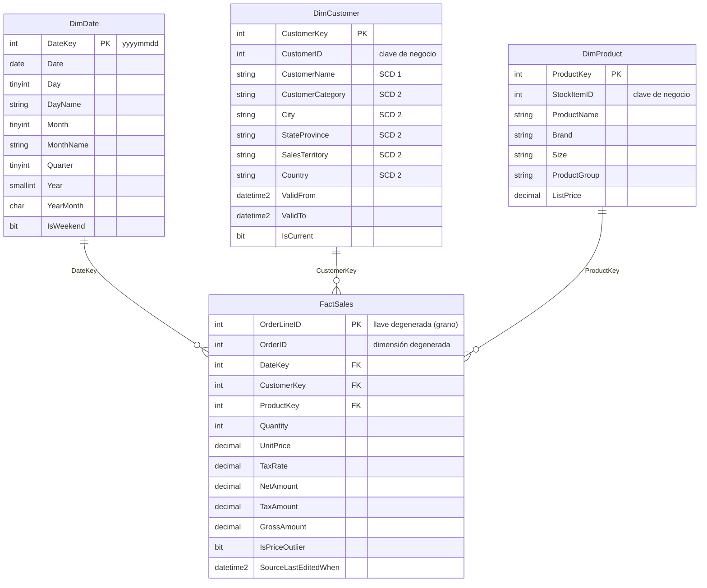

# 4. Modelo dimensional (Data Warehouse)

## Diseño (paso a paso)
1. **Proceso de negocio:** ventas.
2. **Grano:** **una fila por línea de orden de venta** (`Sales.OrderLines`). No se mezclan filas por orden con filas por línea.
3. **Dimensiones:** cuándo (`DimDate`), quién (`DimCustomer`), qué (`DimProduct`).
4. **Hechos (medidas):** cantidad, precio, importe neto, impuesto, total.
5. **Claves:** sustitutas en las dimensiones (`CustomerKey`, `ProductKey`); la clave de negocio se conserva para trazabilidad.
6. **Historia:** SCD Tipo 2 en cliente, Tipo 1 en producto.
7. **Pruebas:** relaciones (llaves foráneas), grano (clave primaria) y agregaciones (reconciliación).

## Diagrama (esquema estrella)

Se descartó `DimGeography` como tabla aparte: la ubicación de entrega va **desnormalizada dentro de `DimCustomer`** (estrella, no copo de nieve), porque no hay jerarquías que reutilizar.

## Medidas
| Medida | Tipo | Definición |
|---|---|---|
| Quantity | **Aditiva** | Unidades vendidas; se suma por cualquier dimensión |
| NetAmount | **Aditiva** | `Quantity × UnitPrice` (ventas netas, sin impuestos) |
| TaxAmount | **Aditiva** | `NetAmount × TaxRate / 100` |
| GrossAmount | **Aditiva** | `NetAmount + TaxAmount` |
| UnitPrice, TaxRate | **No aditivas** | Nunca se suman; se promedian o se recalculan |
| Ticket promedio | **No aditiva (ratio)** | `Ventas netas ÷ órdenes distintas`; se recalcula, no se suma |
| Clientes activos | No aditiva | `COUNT(DISTINCT CustomerID)`; no se puede sumar entre periodos |
| (Semi-aditiva) | — | Este modelo no incluye saldos de inventario; si se agregara, no se sumaría en el tiempo |

## Política de claves, nulos y miembros desconocidos
- Cada dimensión tiene un miembro `-1` «Desconocido» (cliente y producto). Un hecho sin dimensión correspondiente apunta a `-1` (hoy deberían ser 0; se verifica en la reconciliación).
- No hay miembro desconocido en `DimDate`: la fecha del pedido es obligatoria; si falta, el registro va a cuarentena (`ORDER_DATE_INVALID_OR_NULL`).
- Marca y tamaño nulos del producto → `No aplica`. No se reemplazan medidas nulas por cero.
- **Un producto está en varios grupos** en el origen. Se toma el de menor `StockGroupID` como grupo principal; si no, el join multiplicaría las ventas.

## SCD (historia de cambios)
| Dimensión | Atributo | Tipo | Comportamiento |
|---|---|---|---|
| DimCustomer | CustomerName | Tipo 1 | Se sobrescribe en todas las versiones |
| DimCustomer | CustomerCategory, City, StateProvince, SalesTerritory, Country | **Tipo 2** | Se cierra la versión vigente (`ValidTo`, `IsCurrent = 0`) y se crea una nueva |
| DimProduct | todos | Tipo 1 | Se sobrescribe |

Restricción: un índice único filtrado (`IsCurrent = 1`) garantiza **una sola versión vigente por cliente**. Las ventas ya cargadas conservan la versión con la que se cargaron; las nuevas usan la vigente (limitación: la clave se resuelve con la versión vigente **al momento de la carga**, no por la fecha del pedido).

## Carga
Orden: `DimDate → DimProduct → DimCustomer → FactSales` (las claves se resuelven **antes** de insertar hechos). Procedimientos `dw.usp_load_*`, ejecutados por `etl/load_dw.py` en una transacción por paso. `FactSales`: carga inicial desde 1900-01-01; incremental desde `watermark − 1 día`; upsert por `OrderLineID` (actualiza si cambió una medida, inserta si es nueva).

## Reconciliación
`database/scripts/04_reconciliation.sql` compara origen, staging y DW:
1. Conteo por capa (origen, raw, clean, cuarentena, DW).
2. Regla: **origen = DW + cuarentena** (diferencia 0).
3. Ventas netas totales y por año: origen vs DW.
4. Hechos con dimensión desconocida.

Evidencia automatizada: `python tests/e2e_check.py`.

## Diccionario de `FactSales`
| Columna | Tipo | Descripción |
|---|---|---|
| OrderLineID | int PK | Línea de orden en el origen (llave degenerada, define el grano) |
| OrderID | int | Orden a la que pertenece (dimensión degenerada) |
| DateKey | int FK | Fecha del pedido (yyyymmdd) |
| CustomerKey | int FK | Versión del cliente vigente al cargar |
| ProductKey | int FK | Producto |
| Quantity | int | Unidades |
| UnitPrice | decimal(18,2) | Precio unitario |
| TaxRate | decimal(5,2) | % de impuesto |
| NetAmount / TaxAmount / GrossAmount | decimal(18,2) | Importes |
| IsPriceOutlier | bit | Precio atípico (> Q3 + 3·IQR); marcado, no eliminado |
| SourceLastEditedWhen | datetime2 | Última modificación en el origen (watermark) |
| LoadedAt / UpdatedAt | datetime2 | Auditoría de carga |

Índices: PK en `OrderLineID`; no agrupados en `DateKey`, `CustomerKey`, `ProductKey`.

## Vistas y esquemas adicionales
- `dw.vw_monthly_sales`: ventas mensuales (vista analítica controlada para ML y consultas del asistente).
- `ml`, `alerts`, `ai`: ver documentos 07, 08 y 09.
