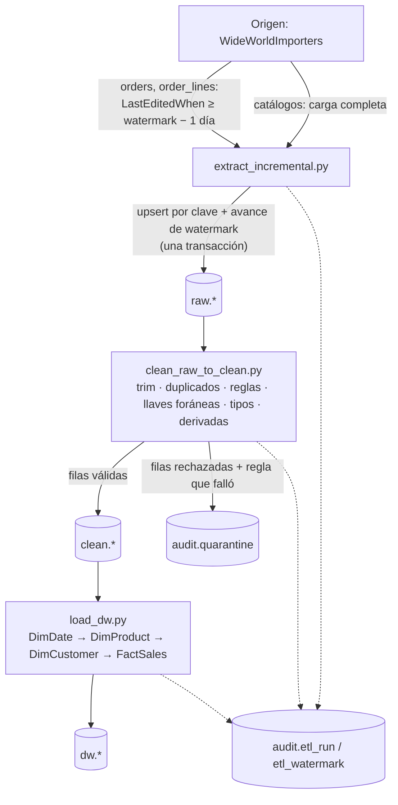

# 5. ETL, calidad de datos y orquestación

## Diagrama de extracción, transformación y carga

## Orquestación
`python etl/run_pipeline.py` ejecuta en orden: **1)** extracción incremental, **2)** limpieza, **3)** carga del DW. Si un paso falla, se detiene y muestra dónde. No se usó Airflow porque no hay dependencias complejas ni programación avanzada que lo justifiquen; para automatizarlo basta el Programador de tareas de Windows (o cron) llamando a ese comando.

Carga **inicial**: `extract_to_raw.py` (copia completa) → `clean_raw_to_clean.py` → `load_dw.py`. Cargas **siguientes**: `run_pipeline.py`.

## Carga incremental e idempotencia
- **Watermark** por proceso en `audit.etl_watermark`. Si no existe, se toma el máximo ya cargado en `raw`.
- **Ventana de solapamiento:** se lee desde `watermark − 1 día` para cubrir registros tardíos.
- **Upsert:** se eliminan de `raw` las claves recibidas y se insertan las nuevas versiones; el watermark se actualiza **en la misma transacción**, es decir, solo si todo salió bien.
- **Actualizaciones:** una línea modificada en el origen reemplaza a la anterior (`rows_updated`). **Eliminaciones:** no se detectan (el origen no marca borrado lógico); es una limitación declarada.
- **Idempotencia:** reejecutar el pipeline sin cambios en el origen produce 0 inserciones nuevas en `FactSales` y no duplica filas (clave primaria + `NOT EXISTS`).
- **Recuperación:** una falla deshace la transacción del paso, deja `status = FAILED` y `error_detail` en `audit.etl_run`, y el watermark no se mueve. Demostrado con `06_demo_recovery.sql`.

## Catálogo de reglas de calidad y transformación
Cada fila rechazada se guarda en `audit.quarantine` con `source_object`, `business_key`, `failed_rule` y el registro en JSON. Invariante verificada en cada tabla: **leídas = limpias + rechazadas** (nada se pierde en silencio).

| Regla (`failed_rule`) | Tabla | Condición | Tratamiento |
|---|---|---|---|
| (espacios y vacíos) | todas | texto con espacios o vacío | `trim`; texto vacío → `NULL` |
| `NULL_KEY` | todas | clave de negocio nula | cuarentena |
| `DUPLICATE_KEY_SUPERSEDED` | todas | clave repetida | sobrevive la fila con `LastEditedWhen` más reciente (o la última); las demás van a cuarentena (no se borran) |
| `CUSTOMER_NAME_NULL` | customers | nombre nulo | cuarentena |
| `ORDER_DATE_INVALID_OR_NULL` | orders | fecha de pedido nula o no convertible | cuarentena |
| `EXPECTED_DELIVERY_BEFORE_ORDER_DATE` | orders | entrega prometida < pedido | cuarentena |
| `QUANTITY_NOT_POSITIVE` | order_lines | cantidad nula o ≤ 0 | cuarentena |
| `UNIT_PRICE_INVALID` | order_lines | precio nulo o < 0 | cuarentena |
| `TAX_RATE_OUT_OF_RANGE` | order_lines | impuesto nulo, < 0 o > 100 | cuarentena |
| `ORPHAN_<columna>_IN_<tabla>` | varias | llave foránea sin padre | cuarentena (política de integridad) |

Llaves foráneas verificadas: `state_provinces.CountryID`, `cities.StateProvinceID`, `stock_item_stock_groups.StockItemID/StockGroupID`, `customers.CustomerCategoryID/DeliveryCityID`, `orders.CustomerID`, `order_lines.OrderID/StockItemID`. Si un pedido se rechaza, sus líneas quedan huérfanas y también van a cuarentena.

## Cobertura de las transformaciones obligatorias
| Actividad | Cómo se cubre |
|---|---|
| Data profiling | `etl/profile_data.py raw` y `clean` → `audit.data_profile` y `documentation/quality/*.csv` (nulos, distintos, mín., máx.) |
| Limpieza | trim, vacío → NULL |
| Nulos | Ver tabla siguiente |
| Duplicados | clave de duplicidad = clave de negocio; supervivencia por `LastEditedWhen` |
| Estandarización | fechas convertidas a un único tipo; texto sin espacios; moneda USD única; sin zonas horarias (fechas de negocio) |
| Tipos de datos | identificadores a entero (nulable donde aplica); fechas con conversión explícita (los errores no truncan: van a cuarentena); importes redondeados a 2 decimales |
| Integridad referencial | verificación de llaves foráneas; huérfanos a cuarentena; en el DW, miembro `-1` «Desconocido» |
| Outliers | `IsPriceOutlier` = precio > Q3 + 3·IQR; se **marca**, no se elimina |
| Reglas de negocio | cantidad > 0, precio ≥ 0, impuesto 0–100, entrega ≥ pedido |
| Enriquecimiento | `LineAmount = Quantity × UnitPrice`, `TaxAmount = LineAmount × TaxRate/100` |
| Integración | joins muchos-a-uno; producto con grupo principal único para no multiplicar medidas |
| Históricos | SCD Tipo 2 en `DimCustomer` |
| Errores / cuarentena | `audit.quarantine` |
| Linaje | columnas `_execution_id`, `_loaded_at`, `_clean_execution_id`, `_cleaned_at` y tabla `audit.etl_run` |

## Política de nulos
| Caso | Campo | Decisión |
|---|---|---|
| No aplica | `BuyingGroupID`, `CreditLimit`, `Brand`, `Size` | Se conserva `NULL` en `clean`; en el DW marca/tamaño se muestran como `No aplica` |
| Pendiente | `PickedQuantity` | Se conserva `NULL` (aún no se prepara el pedido); **no** se rellena con 0 |
| Desconocido | ubicación o categoría sin correspondencia | `Desconocido` en el DW (no se confunde con cero) |
| Error de captura | fecha o cantidad inválida | no se corrige sin regla confiable: cuarentena |
| Medida numérica | importes y cantidades | nunca se reemplazan automáticamente por cero |

No hay imputación estadística en el ETL. En Machine Learning no se imputa: el modelo usa solo la fecha como variable.

## Auditoría mínima (por proceso y ejecución)
`execution_id`, `pipeline_name`, `start_time`, `end_time`, `source_object`, `target_object`, `rows_read`, `rows_inserted`, `rows_updated`, `rows_rejected`, `status`, `error_detail`, `watermark_start`, `watermark_end`.

## Medición de calidad de datos
| Dimensión | Medición | Dónde |
|---|---|---|
| Completitud | % de nulos por columna | `audit.data_profile` (`null_pct`) |
| Unicidad | claves duplicadas | `DUPLICATE_KEY_SUPERSEDED` en cuarentena; PK en el DW |
| Validez | filas que incumplen dominio/formato | reglas de la tabla anterior |
| Consistencia | reglas cruzadas (entrega ≥ pedido) | `EXPECTED_DELIVERY_BEFORE_ORDER_DATE` |
| Integridad | registros huérfanos | reglas `ORPHAN_*` |
| Oportunidad | edad de la última carga | `tests/e2e_check.py` y pestaña *Operación (ETL)* |
