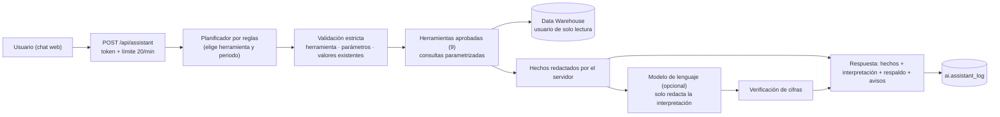

# 8. IA generativa: asistente analítico

## Caso de uso
Chat en la pestaña *Asistente (IA)* que responde en lenguaje natural preguntas sobre las ventas usando **solo datos del Data Warehouse**.

## Arquitectura segura

## Herramientas aprobadas (el modelo **no** ejecuta SQL)
`sales_summary`, `sales_by_dimension`, `dimension_growth`, `monthly_trend`, `forecast_info`, `open_alerts`, `data_status`, `kpi_definition`, `suggest_analysis`. Cada una usa las mismas consultas parametrizadas del dashboard.

Periodos: «último trimestre/mes/12 meses» se interpretan respecto al **último periodo completo de los datos** (no respecto a la fecha de hoy). Los periodos asumidos se informan al usuario. «Disminución relevante» = caída de más de 5%.

## Quién decide qué consultar (`ASSISTANT_PLANNER`)
| Modo | Comportamiento |
|---|---|
| `rules` (por defecto) | Las reglas deciden; el modelo solo redacta. Más fiable con modelos pequeños |
| `hybrid` | Reglas primero; si no entienden, el modelo propone un plan (validado) |
| `llm` | El modelo propone siempre el plan (validado); las reglas son respaldo |

Se aprendió en las pruebas que un modelo local pequeño (3B parámetros) planeaba mal (herramienta o periodo equivocados): con `LLM_PROVIDER=ollama` y el modo `llm` pasaron 9 de 18 preguntas; pasar el control a las reglas lo corrigió.

## Controles de calidad y seguridad
| Requisito de la guía | Control |
|---|---|
| Restringir a datos autorizados | usuario `api_reader`; herramientas fijas; filtros contra valores existentes |
| Validar entradas y limitar frecuencia | 1–500 caracteres; 20 preguntas/min por usuario (`429`) |
| No enviar datos personales a servicios externos | con modelos externos solo viajan la pregunta y cifras agregadas; el desglose por **cliente** está bloqueado; con Ollama nada sale del equipo |
| Mostrar fecha de actualización | cada respuesta lleva «datos hasta» y la última carga |
| Distinguir hechos, predicciones e interpretaciones | etiquetas `HECHOS`, `PREDICCIÓN` e `INTERPRETACIÓN GENERADA POR IA` |
| Respuestas con métricas y periodos | los hechos los redacta el servidor con periodo y cifras |
| «No hay datos suficientes» | estados `NO_DATA` y `OUT_OF_SCOPE`; el modelo no se invoca si no hay datos |
| Registrar consultas con privacidad | `ai.assistant_log`: usuario, pregunta (≤ 500), estado, herramientas, tiempo; **sin resultados** |
| Preguntas ambiguas / fuera de alcance / inexistentes | pruebas incluidas |
| Cifras inventadas | verificación aproximada: las cifras ≥ 10 del texto generado se buscan en los datos consultados (tolerancia 1%, escalas k/M); si no aparecen se muestra una advertencia |
| Inyección de prompt / SQL | la pregunta nunca se convierte en SQL; plan y parámetros se validan contra listas blancas |

## Qué se envía a servicios externos (si se activan)
Solo con `LLM_PROVIDER=openai|anthropic`: el texto de la pregunta y las líneas de «Datos consultados» (cifras agregadas por periodo, grupo, categoría o territorio). Nunca filas individuales ni nombres de clientes. Con `ollama` o `none` no sale nada. Requiere autorización institucional si los datos fueran reales.

## Pruebas
- `python tests/test_assistant.py`: 18 pruebas con base falsa (herramientas, rechazos, plan inválido, privacidad, cifras inventadas, falla del modelo).
- `python generative_ai/evaluate_assistant.py`: **18 preguntas contra el DW real**, con resultado esperado, consulta de respaldo, respuesta, cifras no verificadas y contraste con SQL independiente. Incluye 2 casos «sin información suficiente» (año 2030, territorio inexistente) y casos fuera de alcance, ambiguo e inyección. Reporte: `documentation/genai/assistant_test_results.md`.

## Límites
- En modo reglas, el reconocimiento de preguntas es por palabras clave: frases muy distintas a los ejemplos pueden caer en «fuera de alcance».
- «Categoría» se interpreta como grupo de producto, salvo que diga «categoría de cliente».
- La verificación de cifras es aproximada; no garantiza que todo el texto generado sea correcto, por eso los hechos aparecen aparte.
- Un modelo local pequeño puede redactar de forma torpe; las cifras siempre salen de la sección de hechos.
- El asistente responde, no actúa: no modifica datos.
