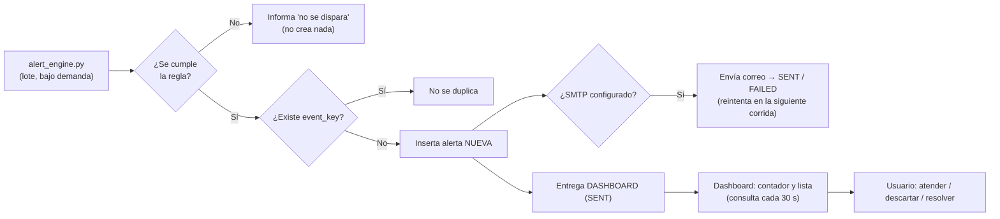

# 9. Alertas y automatización

## Reglas
| Código | Tipo | Se dispara cuando… | Umbral |
|---|---|---|---|
| `SALES_DROP` | Regla de negocio | las ventas netas del mes caen más de X% frente al **promedio de los 3 meses anteriores** | 15% |
| `FORECAST_DROP` | Machine Learning | la **predicción** del próximo mes está más de X% por debajo del promedio de los últimos 3 meses reales | 15% |

Los umbrales viven en `alerts.alert_rule` y pueden sustituirse temporalmente con `--threshold`. Severidad: **ALTA** si la caída es ≥ 2× el umbral; **MEDIA** en otro caso. (La alerta basada en IA generativa queda como extensión opcional.)

## Contenido de una alerta (`alerts.alert`)
Identificador y fecha/hora · tipo (origen: `RULE` / `ML`) y severidad · indicador y entidad · valor observado o predicho · referencia y periodo · umbral y cambio % · versión del modelo (si aplica) · explicación y acción recomendada (plantillas fijas, no IA) · bandera `is_simulated` · estado: **NUEVA, ATENDIDA, DESCARTADA, RESUELTA** (con quién y cuándo lo cambió).

## Flujo de principio a fin


## Control de duplicados
Cada evento tiene una `event_key` única (por ejemplo `SALES_DROP|2016-05` o `FORECAST_DROP|<modelo>|2016-06`) con restricción `UNIQUE` en la base de datos. Reejecutar el motor con el mismo evento responde «ya existía: NO se duplica».

## Entrega y registro (`alerts.delivery`)
Una fila por alerta y canal: `DASHBOARD` (siempre) y `EMAIL` (opcional): estado `SENT`/`FAILED`, intentos, último intento y error. El correo reintenta una vez por corrida del motor hasta 5 intentos.

## «Tiempo real»
Las alertas se generan **cuando se ejecuta el motor** (por lotes). La latencia mínima es el tiempo entre cargas del DW más la frecuencia con la que se ejecute el motor. El dashboard revisa alertas nuevas cada 30 segundos, pero eso no las hace inmediatas. Para inmediatez harían falta CDC o procesamiento continuo. **Los eventos de demostración se identifican como `SIMULADA`** (opción `--simulate-drop`).

## Uso
```
python notifications/alert_engine.py                      # evalúa el último mes completo y la predicción
python notifications/alert_engine.py --scan               # variación de todos los meses (no crea alertas)
python notifications/alert_engine.py --month 2015-12      # reproduce un mes histórico (datos reales)
python notifications/alert_engine.py --threshold 5        # umbral temporal
python notifications/alert_engine.py --simulate-drop 30   # evento SIMULADO
```
Para automatizarlo: ejecutar el pipeline, `predict_forecast.py` y el motor en secuencia desde el Programador de tareas.

## Pruebas
`python tests/test_alert_rules.py` (7 pruebas): condición falsa y verdadera, sin referencia, umbral exacto, severidad, simulación, alerta por predicción y misma clave para el mismo evento. En vivo: condición falsa, condición verdadera, repetición (sin duplicado), consulta de detalle y estado, y falla de correo con reintento (si se configura SMTP).

## Correo (opcional)
Variables `SMTP_HOST`, `SMTP_PORT`, `SMTP_USER`, `SMTP_PASSWORD`, `ALERT_EMAIL_TO` en `.env`. Con Gmail se requiere una contraseña de aplicación. Si no se define, solo se notifica en el dashboard.
